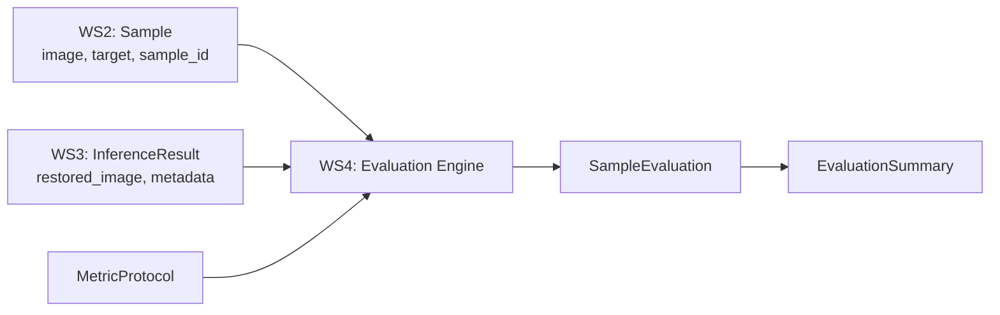

# Evaluation Engine WS4-02

## Mục tiêu và vị trí kiến trúc

Evaluation Engine là ranh giới đánh giá thuộc WS4, thực thi Contract C-05. Thành phần này không chạy mô hình, không đọc dataset layout trực tiếp và không ghi cấu hình thí nghiệm. Nó nhận ảnh dự đoán đã khôi phục từ WS3 và ground truth từ WS2, sau đó tạo phép đo PSNR/SSIM có nguồn gốc rõ ràng.

Mỗi đầu vào thực tế của WS2/WS3 phải là RGB `float32` CHW trong miền `[0,1]`. Engine không sửa `Sample`, `InferenceResult` hoặc model metadata của provider.

## Thành phần

- `protocol.py` định nghĩa `MetricProtocol` bất biến và registry ba protocol. Profile chứa ID/version, source evaluator, representation, quantization, crop, Y-channel, biến thể SSIM, yêu cầu thiết bị và trạng thái khả dụng.
- `errors.py` phân biệt dữ liệu đầu vào không hợp lệ, protocol không tồn tại, protocol có chủ đích chưa khả dụng và lỗi thực thi metric.
- `engine.py` chuyển representation, xác thực C-02/C-03/C-04, gọi adapter metric, tạo kết quả theo mẫu và tổng hợp batch.
- `__init__.py` là public boundary duy nhất của package.

`CpuBasicSRAdapter` là implementation CPU cho protocol `group-basicsr-cpu`; nó không import hay thay đổi submodule upstream.

## Luồng xử lý và validation

`evaluate_sample` trước hết resolve protocol mà không chọn fallback. Với `realblur-official`, engine trả `ProtocolUnavailableError`; với `upstream-basicsr`, caller phải cung cấp adapter BasicSR/CUDA tường minh.

Sau đó engine kiểm `sample_id` prediction và target, GT tồn tại, dtype `float32`, 3 kênh, CHW không rỗng, giá trị hữu hạn, miền `[0,1]` và shape giống nhau. Mọi sai lệch trả exception có context; không sinh metric giả.

Ảnh hợp lệ được clamp, đổi CHW sang HWC, đảo RGB sang BGR, nhân 255 và làm tròn thành `uint8`. Hai ảnh dùng cùng một representation trước khi gọi PSNR/SSIM. Đây là mô phỏng rõ ràng đường validation `tensor2img` đã audit trong BasicSR, không truyền NCHW trực tiếp vào evaluator.

## API và kết quả

`evaluate_sample(result, sample, protocol, *, basicsr_adapter=None)` trả `SampleEvaluation`. Đối tượng này chứa `sample_id`, PSNR, SSIM, metadata protocol và `model_metadata` nếu `InferenceResult` có cung cấp. `measurement_kind` cố định là `group-measured`; nó không suy diễn paper result, checksum hay checkpoint identity.

`evaluate_batch(results, samples, protocol, *, basicsr_adapter=None)` kiểm sample ID trùng, prediction thiếu/thừa và giữ thứ tự từ `results`. Mẫu không GT không được gọi metric: chúng xuất hiện trong `EvaluationSummary.excluded` với lý do. Summary cung cấp mean PSNR/SSIM, số hợp lệ và số bị loại trừ.

PSNR vô cực khi hai ảnh giống hệt nhau là hợp lệ. `to_dict()` biểu diễn vô cực bằng chuỗi `"inf"`, để JSON metadata không biến một phép đo hợp lệ thành `null`; aggregate vẫn giữ vô cực theo toán học nếu batch có mẫu vô cực.

## Xử lý lỗi và giới hạn

`EvaluationInputError` dùng cho GT thiếu, IDs/shape không khớp và tensor sai contract. `UnknownProtocolError` bảo đảm ID sai không dẫn đến BasicSR CPU. `MetricExecutionError` giữ lỗi phát sinh trong evaluator. `ProtocolUnavailableError` biểu đạt điều kiện có chủ đích: upstream SSIM 3D cần CUDA hoặc RealBlur official chưa được triển khai.

WS4-02 không tạo config, CLI, metadata experiment hoàn chỉnh hay integration pipeline; các phần đó thuộc WS4-03 và WS4-04. Không có benchmark GoPro/RealBlur, không có assertion về chất lượng mô hình và không gọi CPU variant là reproduction upstream.
