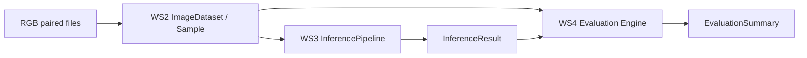

# Kiến trúc tích hợp WS1–WS4

## Luồng dữ liệu

WS4-04 kiểm chứng các public boundary của hệ thống, không tạo một pipeline mới. WS2 đọc PNG/JPEG RGB thành `Sample`; WS3 nhận `Sample.image`, reflection-pad tới bội số 32 và trả `InferenceResult`; WS4 so khớp ID, GT và shape trước khi tính metric.

## Boundary và provenance

`Sample` mang `image`, `target`, `sample_id` và cờ GT. `InferenceResult` giữ ảnh đã crop về kích thước gốc, padding, device, model identity và metadata. `EvaluationSummary` chỉ tổng hợp mẫu có GT; mẫu không GT được ghi exclusion thay vì tạo target giả.

Trong integration test, `MockModel` của WS3 được dùng để kiểm tra contract pipeline, không phải FFTformer. `is_mock=True` và metadata mock được giữ trong `InferenceResult` rồi truyền vào `SampleEvaluation`. Đường CLI WS4-03 vẫn dành cho prediction images đã có sẵn; metadata `precomputed-prediction-images` không dùng để mô tả mock inference.

## Padding, alignment và lỗi

WS3 chỉ pad cạnh phải/dưới bằng reflection trước model và crop kết quả về H×W gốc. WS4 do đó nhận prediction cùng spatial extent với target, không tính metric trên padding. ID phải trùng, pair phải đầy đủ một-một và ảnh phải là RGB float32 trong `[0,1]`; mismatch, tensor sai, protocol lạ hay RealBlur unavailable đều trả lỗi rõ thay vì kết quả mặc định.

## Phạm vi chứng minh

Integration CPU dùng ảnh synthetic RGB và metric PSNR/SSIM thật của `group-basicsr-cpu`. Nó chứng minh WS2→WS3→WS4 cùng hoạt động, thứ tự batch được giữ và aggregate/provenance đúng. Nó không chứng minh checkpoint FFTformer, inference mô hình thật, CUDA, benchmark GoPro/RealBlur hay RealBlur ECC evaluator.
